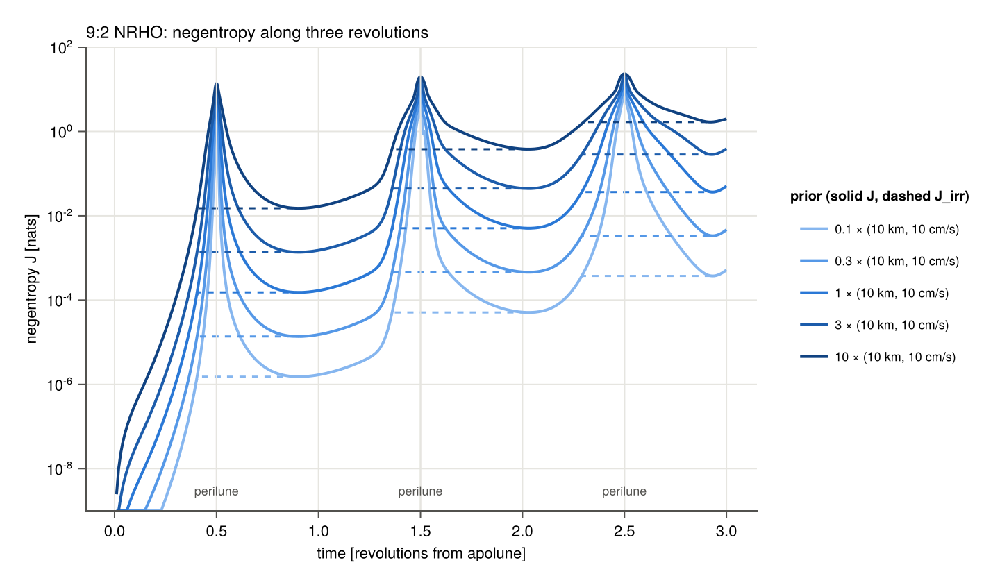
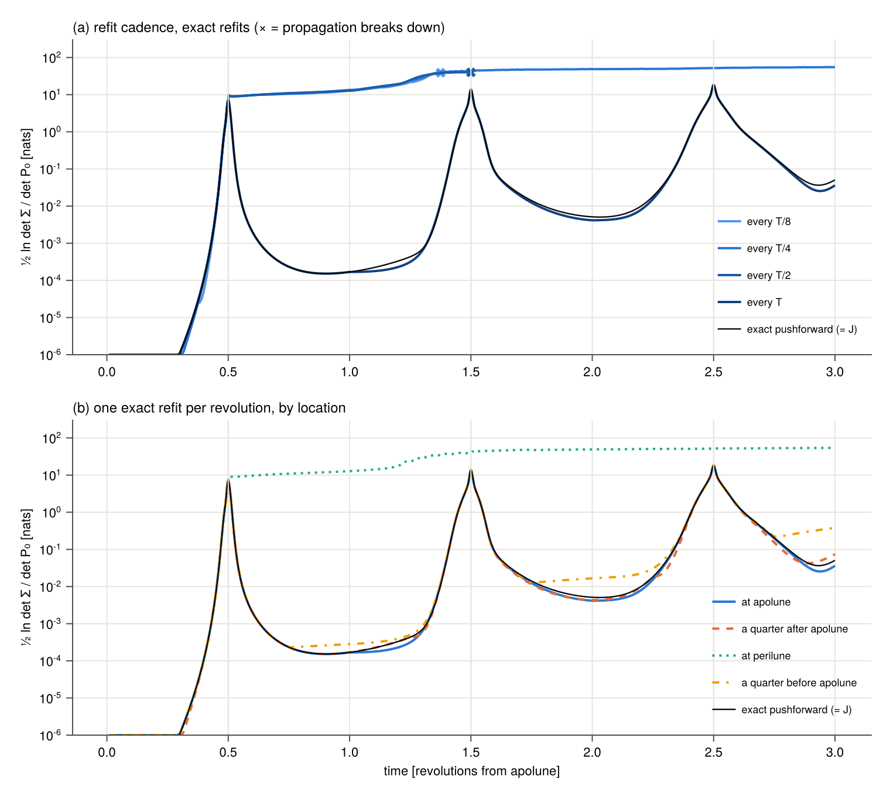
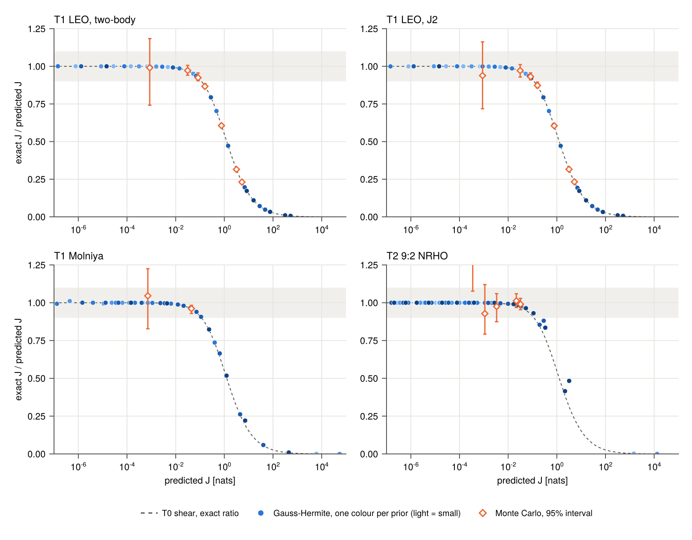
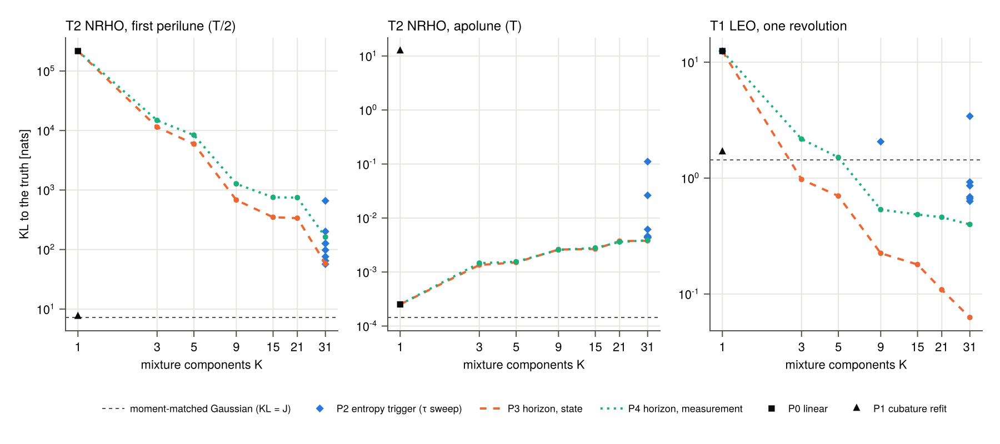
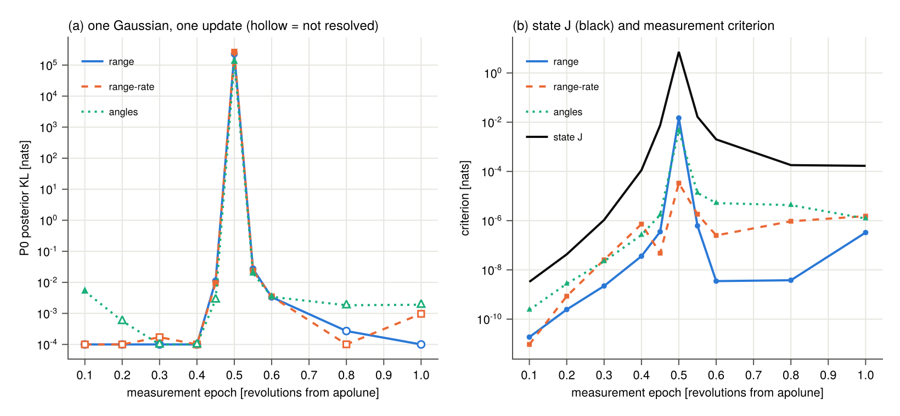
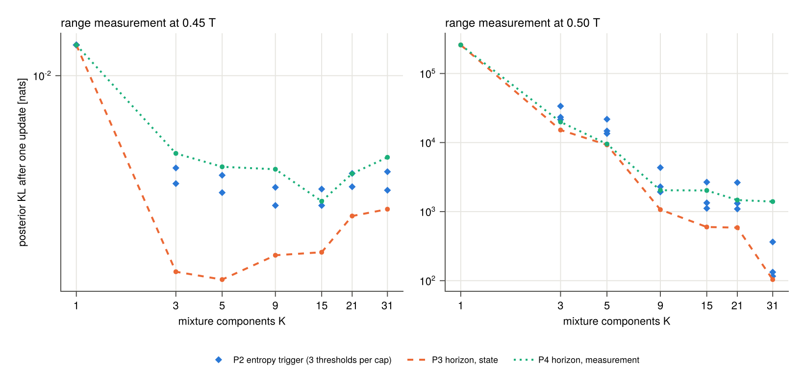
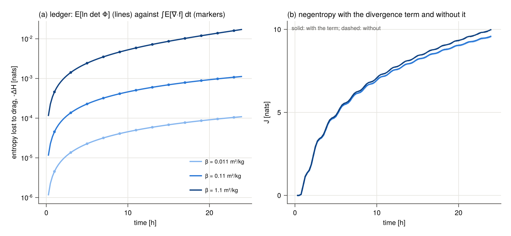

# LiouvilleMixtures.jl

[](https://github.com/OrbitAR7/LiouvilleMixtures.jl/actions/workflows/CI.yml)

Entropy accounting for Gaussian and Gaussian-mixture uncertainty propagation on
orbital flows that preserve phase volume: Kepler, J2 and the Earth-Moon circular
restricted three-body problem (CR3BP).

On such a flow the entropy of the propagated density is conserved. So the
negentropy of an exactly propagated Gaussian equals the log growth of its
covariance volume, and refitting a Gaussian can only add volume. This repository
measures what that implies on the 9:2 near-rectilinear halo orbit (NRHO) and on
two Earth orbits. It also tests whether a split decision made in measurement
space, by looking ahead to the next measurement, needs fewer mixture components
than an instantaneous entropy trigger.

**Findings at a glance.** Details, intervals and figures are below; numbers are
in nats.

- **The measurement-space split criterion is not supported.** This was H5, and
  it is refuted as stated.
  - At perilune the instantaneous entropy trigger reaches 50% and 25% of a single
    Gaussian's posterior error with 3 components, the same as the look-ahead
    policies.
  - The measurement-space criterion is never better than the state-space one. It
    is clearly worse at 31 components: 1.4×10³ [370, 2.8×10³] against 104
    [27, 204] for the state-space criterion.
  - The state-space look-ahead beats the entropy trigger by a factor of 1.4 to
    2.2 at equal component count, but the intervals overlap.
- **Refitting ratchets volume.** With exact refits the covariance volume never
  decreased between refits. The smallest step over every schedule tried was
  +6×10⁻⁹. The exact pushforward's volume rises at every perilune and falls back.
- **Perilune non-Gaussianity is almost entirely reversible.** On the NRHO, the
  negentropy at the first perilune is 4.0 to 13.8 for priors from (1 km, 1 cm/s)
  to (100 km, 1 m/s). By apolune 99.9% to 100% of it is gone. The part that is
  not reversible grows 5- to 30-fold per revolution.
- **Where you refit matters far more than how often.** With one exact refit per
  revolution, the volume after three revolutions is 0.036 if the refit is at
  apolune. A single refit at perilune already locks in 7.23. Repeated perilune
  refits produce Gaussians that put 17% to 34% of their probability on
  trajectories that crash into the Moon.
- **The leading-order negentropy predictor works to about 0.1.** It is within
  10% of the exact value in every problem up to a predicted negentropy of about
  0.1.
  - Beyond that the exact value tracks ½ ln(1 + 2 J_pred).
  - For an exactly quadratic, volume-preserving map that expression is a
    derived lower bound, attained when the nonlinearity has one direction.
  - LEO sits on the bound to 0.01%. Molniya and the NRHO lie above it.

## Problems

1. Why do filters that refit a Gaussian on a schedule gain covariance volume
   they never lose, and how large is the effect on the 9:2 NRHO?
2. How much of the non-Gaussianity near perilune is reversible, meaning it
   disappears later without any measurement, and how does that depend on
   coordinates?
3. Does a split decision made by looking ahead to the next measurement, in
   measurement space, beat an instantaneous entropy trigger at equal component
   count?

## Methods

- **Dynamics and tensors.** Two-body, J2 and CR3BP models, plus drag for the
  non-conservative case.
  - First- and second-order state transition tensors are integrated with the
    variational equations (Park and Scheeres 2006) using Vern9.
  - They are checked against finite differences and against jet transport
    (TaylorIntegration.jl).
  - The CR3BP equations and the 9:2 NRHO come from
    [OrbitalMechanics.jl](https://github.com/OrbitAR7/orbital-mechanics-jl).
- **Identities I1 to I4 and the shear-closure bound,** derived in
  [docs/src/derivations.md](docs/src/derivations.md):
  - I1: the density is carried along trajectories.
  - I2: negentropy equals ½ ln det Σ_t − ½ ln det P₀.
  - I3: moment matching through a volume-preserving map cannot shrink the
    covariance volume.
  - I4: the leading-order negentropy J ≈ ¼ΣB²_abc + ½ΣB_abcB_bac = ‖κ₃‖²/12,
    from the whitened second-order tensor B. It is derived through the
    covariance, using the constraint that volume preservation places on the
    third-order tensor, and through an Edgeworth expansion.
  - The closure bound ½ ln(1 + 2 J_pred) ≤ J ≤ J_pred, for exactly quadratic
    volume-preserving maps.
- **Exact references:**
  - Gauss-Hermite rules (5⁶ and 7⁶ nodes) in whitened coordinates.
  - Paired Monte Carlo (up to N = 5×10⁵), with bootstrap intervals and
    log-determinants from a QR factorization.
  - KL divergence to the truth, using the exact prior log-density with no
    density estimation.
  - The exact posterior, by likelihood-weighted prior samples.
- **Six policies:**

| | Policy | Splits or refits when |
|---|---|---|
| P0 | `LinearPropagation` | never; propagates by the state transition matrix |
| P1 | `ScheduledRefit` | on a fixed schedule (unscented, or exact Gauss-Hermite moment matching) |
| P2 | `EntropyTrigger` | the accumulated per-step entropy difference exceeds τ (after DeMars, Bishop and Jah 2013) |
| P3 | `HorizonSplit` | the predicted negentropy at the next epoch exceeds τ (state space) |
| P4 | `HorizonSplit` with a measurement | the predicted negentropy of the next measurement exceeds τ |
| P5 | `HorizonSplit` with merging | as P4, with Runnalls (2007) merge-back |

  - The split library (three components, matched in moments up to the fifth
    order) and Runnalls' bound come from
    [EstimationToolkit.jl](https://github.com/OrbitAR7/EstimationToolkit.jl).
  - Measurement updates are Gaussian-sum EKF updates (Alspach and Sorenson 1972).

## Findings

All numbers come from [results/summary.md](results/summary.md), which the scripts
generate. Intervals are 95% unless stated. Gauss-Hermite values are
deterministic and carry no interval.

### Reversible and irreversible negentropy (E1)



| Prior, × (10 km, 10 cm/s) | J at 1st perilune | Reversible fraction | J at 1 rev | J at 2 rev | J at 3 rev |
|---|---|---|---|---|---|
| 0.1 | 4.01 | 1.0000 | 1.7e-6 | 5.2e-5 | 5.2e-4 |
| 1 | 7.23 | 1.0000 | 1.7e-4 | 5.1e-3 | 0.051 |
| 10 | 13.8 | 0.9989 | 0.017 | 0.39 | 1.99 |

- **The mechanism.** A 1 km along-track error at apolune becomes an 18 km arc at
  perilune, on a 3249 km radius. That arc's curvature dominates the direction the
  flow has squeezed.
- **It is not a numerical artifact:**
  - The linear-map control gives J ≈ 10⁻¹² there.
  - Gauss-Hermite 5⁶ and 7⁶ agree to four decimals.
  - Monte Carlo agrees to within 0.2%. An independent reproduction (own
    integrator, N = 10⁶) gives 7.234 [7.227, 7.240].
- **The irreversible floor at apolune** grows by ×30 then ×10 per revolution at
  the middle prior, and ×23 then ×5 at the largest.
- **Molniya** loses less of its non-Gaussianity. Over ten revolutions, the part
  of the first-perigee negentropy that is not reversible is 2.4 to 7.1.
- **Coordinates change everything.** After one revolution with a 1 km / 1 m/s
  prior:

| Orbit | Cartesian J | Modified equinoctial J |
|---|---|---|
| LEO | 1.439 [1.431, 1.448] | 1.9e-4 [1.0e-4, 2.7e-4] |
| Molniya | 13.34 [13.30, 13.37] | 2.08 [2.06, 2.10] |

  The equinoctial value includes the Jacobian term. The ratio agrees in direction
  with Gupta and DeMars (2026).

### The refit ratchet (E2)



- **Exact refits never lost volume.** On the NRHO with exact (5⁶) refits, the
  smallest step between refits over all schedules was +6×10⁻⁹. Cubature refits
  violate this slightly (−0.003), as approximate moment matching can.
- **Location dominates.** One refit per revolution:

| Refit location | Volume after 3 rev | Largest lunar-impact probability of a refitted Gaussian |
|---|---|---|
| Apolune | 0.036 (exact pushforward: 0.051) | 0.000 [0.000, 0.001] |
| A quarter after apolune | 0.074 | 0.000 [0.000, 0.001] |
| A quarter before apolune | 0.38 | 0.000 [0.000, 0.001] |
| Perilune | about 54 (not physical after 1.5 T) | 0.338 [0.323, 0.353] |

- **One perilune refit is enough.** It locks in 7.23, which equals J at
  perilune.
- **Lunar impacts.** The impact probability is Monte Carlo: 4000 draws from each
  refitted Gaussian, flown to the next refit.
  - The first perilune refit puts no probability inside the Moon.
  - After it has inflated the covariance (to about 39), the next refitted
    Gaussian has 17% to 34% of its probability on trajectories that pass below
    the lunar surface with exact refits, and up to 43% with cubature refits. That
    holds for every schedule with perilune refits; the true pushforward has none.
  - From that refit on, the volumes (48 to 56 at 3T) are indicative only.
  - Two schedules break down outright, because quadrature nodes fall into the
    point-mass Moon.

### The negentropy predictor (E3)



- **Range of validity.** Over 248 converged points (LEO, LEO with J2, Molniya,
  NRHO; many times and priors), the predictor is within 10% while it predicts
  below 0.086 to 0.11, depending on the problem. Beyond that it overestimates:

| Predicted J | Median exact / predicted |
|---|---|
| 0.1 – 0.3 | 0.85 |
| 0.3 – 1 | 0.67 |
| 1 – 10 | 0.32 |

- **The shear closure.** Beyond leading order the exact values track
  ½ ln(1 + 2 J_pred). For a map that is exactly quadratic and volume-preserving,
  ½ ln(1 + 2 J_pred) ≤ J ≤ J_pred, with equality on the left when the
  nonlinearity has rank one (derivation in
  [docs/src/derivations.md](docs/src/derivations.md)). The data sit on or above
  that bound everywhere:

| Problem | Exact / closure, min – max (0.01 < J_pred < 10) |
|---|---|
| LEO | 1.0000 – 1.0001 |
| LEO with J2 | 1.0000 – 1.0001 |
| Molniya | 1.0004 – 1.16 |
| NRHO | 1.0015 – 1.55 |

  On LEO the nonlinearity is the curvature of the arc, r(1 − δθ²/2) with δθ
  Gaussian: a rank-one quadratic shear.

### Prediction-only accuracy against component count (E4)



KL from the true propagated density, with 31 components where a mixture is used:

| Case | P0 linear | Best single Gaussian (= J) | P3 (state) | P4 (measurement) | Best P2 |
|---|---|---|---|---|---|
| NRHO, first perilune | 2.2×10⁵ | 7.22 | 58.5 [46.8, 70.1] | 162 [137, 187] | 56.8 [43.2, 70.5] |
| NRHO, apolune | 2.5×10⁻⁴ | 1.4×10⁻⁴ | 0.0038 | 0.0039 | 0.0043 |
| LEO, 1 rev | 12.5 | 1.43 | 0.063 [0.061, 0.065] | 0.398 [0.395, 0.402] | 0.63 |

- **Perilune:** mixtures of linearly propagated components stay eight times worse
  than one well-fitted Gaussian.
- **Apolune:** splitting only adds error, because the non-Gaussianity has already
  reversed.
- **LEO:** mixtures help a lot.
- **P4 against P3:** P4 is worse at perilune and on LEO, and the intervals do not
  overlap.

### Posterior accuracy after one update (E5)




- **Where a single Gaussian's posterior fails.** Its error is resolved only
  between 0.45 and 0.6 T: 0.004 to 0.03 on either side of perilune, about 10⁵ at
  perilune. Elsewhere it is within the ±0.003 floor of the estimator.
- **The measurement-space criterion** spans three orders of magnitude across
  measurement types, while their posterior errors are not separable within their
  intervals.
- **Components needed at perilune** (range measurement) to reach a fraction of
  P0's posterior KL. P2 was run at every cap, with three thresholds fixed in
  advance:

| Target | P2 (best τ) | P2 (worst τ) | P3 | P4 |
|---|---|---|---|---|
| 50% | 3 | 3 | 3 | 3 |
| 25% | 3 | 3 | 3 | 3 |
| 10% | 5 | 9 | 3 | 5 |

- **At equal component count at perilune:**

| K | P3 | P4 | P2 (three thresholds) |
|---|---|---|---|
| 3 | 1.52×10⁴ [0.79, 2.46]×10⁴ | 1.99×10⁴ | 2.2 – 3.4×10⁴ |
| 31 | 104 [27, 204] | 1.4×10³ [370, 2.8×10³] | 116 – 364 |

- **Split directions.** At perilune the whitened nonlinearity is close to rank one
  (second eigenvalue 7×10⁻⁶ of the first). The two criteria still choose
  directions 26° to 31° apart for range and range-rate, because the measurement
  tensor adds the curvature of h itself. For angles they nearly coincide.

### Drag (E6)



- **The ledger closes.** On a 400 km orbit with drag, two independent routes give
  the entropy lost to drag over a day: the mean of each sample's ln det Φ, and the
  integral of the mean flow divergence. They agree to a relative 1×10⁻⁶ to 3×10⁻⁵.
- **The term is negligible.** The loss is 1.1×10⁻⁴ per day at nominal drag
  (β = 0.011 m²/kg) and 0.017 per day at 100 times that. Leaving the term out
  changes J (about 9.6) by a relative 1×10⁻⁵ to 2×10⁻³.

## Claims

| Claim | Script | Figure | Test | Status |
|---|---|---|---|---|
| I1–I3 hold on these flows (det Φ = 1; J = ½ ln det Σ_t/P₀; exact refits cannot shrink volume) | `e1_reversibility.jl`, `e2_ratchet.jl` | e1_nrho, e2_ratchet | `test_tensors.jl`, `test_entropy.jl`, `test_policies.jl` ("ratchet") | supported |
| H1: scheduled exact refits never lose volume; the exact pushforward's volume rises and falls | `e2_ratchet.jl` | e2_ratchet | `test_policies.jl` ("P1 exact refits never lose covariance volume") | supported |
| H2a: most of the NRHO perilune negentropy is reversible within one revolution | `e1_reversibility.jl` | e1_nrho | (Gauss-Hermite vs Monte Carlo checks in E1) | supported |
| H2b: the irreversible part grows slowly and is tied to along-orbit shear | `e1_reversibility.jl` | e1_nrho, e1_molniya | – | inconclusive (it grows 5- to 30-fold per revolution; the link to shear was not tested) |
| H3: the volume gained by refitting depends mainly on where the refits fall | `e2_ratchet.jl` | e2_ratchet | – | supported |
| H4: the leading-order negentropy is predicted by the whitened second-order tensor alone (I4) | `e3_predictor.jl` | e3_predictor | `test_predictor.jl` (T0, 2D twist map, orbits against Gauss-Hermite) | supported, within 10% for predicted J ≲ 0.1 nats |
| Beyond leading order, J ≥ ½ ln(1 + 2 J_pred), with equality for a rank-one shear | `e3_predictor.jl` | e3_predictor | – | supported: derived for exactly quadratic maps; every point satisfies it; LEO sits on it to 0.01% |
| H5: a measurement-space split criterion at the next measurement reaches the entropy trigger's posterior accuracy with fewer components | `e5_posterior.jl` | e5_policies | `test_policies.jl` (criterion against quadrature) | refuted (at perilune the trigger needs the same 3 components for 50% and 25%, and 5–9 against 5 for 10%) |
| The measurement-space criterion splits better than the state-space one | `e4_accuracy.jl`, `e5_posterior.jl` | e4_accuracy, e5_policies | – | refuted (never better; worse with non-overlapping intervals in E4 at perilune and on LEO, and in E5 at 31 components) |
| A look-ahead state-space split beats the instantaneous trigger at equal component count | `e5_posterior.jl` | e5_policies | – | inconclusive (1.4–2.2× better at perilune; the intervals overlap) |
| The measurement-space criterion predicts which measurement type's posterior suffers most | `e5_posterior.jl` | e5_along_orbit | – | inconclusive (the posterior errors are not separable within their intervals) |
| Repeated perilune refits put probability on lunar-impact trajectories | `e2_ratchet.jl` | e2_ratchet | – | supported (Monte Carlo: 17%–34% with exact refits after the second perilune refit; 0 after the first) |
| At perilune, mixtures of up to 31 linearly propagated components are worse than one moment-matched Gaussian | `e4_accuracy.jl` | e4_accuracy | – | supported |
| The entropy ledger with drag closes, and the divergence term is negligible at realistic drag | `e6_drag.jl` | e6_drag | `test_update.jl` (Liouville's formula) | supported |

## Verification

- **Tests.** 724 tests in the fast tier, with 100% line coverage of `src/`.
  CI runs on Julia 1.10 (LTS) and the current release on every push. A heavier
  statistical tier runs weekly.
- **Tensors:**
  - det Φ − 1 < 10⁻¹⁰ and the symplectic residual < 10⁻⁹ over a revolution of
    LEO, Molniya and the NRHO. The rotating-frame symplectic form is
    Ω = TᵀJT, not J.
  - Ψ against finite differences < 10⁻⁶, and against jet transport < 10⁻⁸.
- **Estimators:**
  - The T0 shear's exact negentropy lies inside the Monte Carlo interval.
  - KL to the truth matches closed forms.
  - The bootstrap's coverage is regression-tested: 0.933 at N = 2000, and
    nominal 0.95 at N = 2×10⁴ in the full tier.
  - The QR log-determinant stays accurate to condition numbers of 10¹².
  - The posterior KL matches the closed-form Gaussian KL.
- **Cross-checks:**
  - Gauss-Hermite values against Monte Carlo at spot checks (E1, and one prior per
    problem in E3), and against a finer 7⁶ rule (E1, E2 and E3).
  - P2's entropy measure against EstimationToolkit's adaptive mixture filter
    (identical).
  - The measurement-space criterion against a direct quadrature of the third
    cumulant (agreement 10⁻³).
  - Modified equinoctial elements against classical elements (10⁻¹²).
- **Independent review.** A separate review, done without access to the
  implementation notes:
  - Re-derived I1 to I4 and the rotating-frame symplectic form, and found no
    disagreement.
  - Reproduced thirteen reported numbers by independent routes (its own CR3BP
    integrator, analytic Kepler propagation, its own EKF and importance sampling).
    All agree within their intervals.
  - Found the problems corrected in this version:
    - The H5 comparison had run P2 only at a cap of 31.
    - E2 had a lunar-impact check that only ran when integration failed.
    - The impact fraction was a quadrature weight, not a probability.
    - Missing references.
  - It also derived the shear-closure bound.

## Gaps

- **Mixture components are propagated linearly**, by their state transition
  matrices, so every policy reduces exactly to P0. Sigma-point components would
  do better at perilune (E4). That alternative is not studied here.
- **The Moon is a point mass.** With a surface, the impacting trajectories in E2
  would end instead.
- **E5's noise is set relative to the prior, not to real instruments.** Each σ is
  0.2 × the predicted linear standard deviation, which keeps the
  importance-sampling posterior resolvable. Real deep-space-network accuracy
  would need a better ground-truth estimator.
- **E5's resolution is limited.** Its floor is about 1/√ESS (≈ 0.003), and its
  measurements are taken from the Earth's centre rather than a ground station.
- **P5's merge-back is never exercised** in a sequence of updates: E5 uses one
  update. It is unit-tested only.
- **Two tests are weaker than they look.**
  - The "I2 holds on T1" test compares two estimators that are algebraically close
    on the same samples. I2's independent support comes from the Gauss-Hermite,
    Monte Carlo and reproduction checks.
  - The Monte Carlo version of the predictor test is a ±10%-band overlap test,
    in the full tier only. The precise test is against Gauss-Hermite.
- **Molniya** is tested over half and quarter revolutions in the predictor tests.
  Over a full revolution ending at perigee, the predictor's regime lies below
  Float64 resolution.
- **Not reimplemented:** the tensor-based deferral of Siciliano, LeGrand and
  Kulik (2025). P3 is a simpler look-ahead criterion of the same family.
- **Unverified items:**
  - The exponential-atmosphere constants in E6 are illustrative.
  - Horwood, Aragon and Poore (2011) could not be verified, and is not cited.

## Related work

- **Measuring nonlinearity.** Junkins and Singla (2004) give the classic
  treatment for orbits. Jenson and Scheeres (2023) measure it through tensor
  eigenpairs, in the CR3BP and on NRHOs.
  - Our `max_nonlinearity_direction` is a shifted power iteration (Kolda and Mayo
    2011) on a related quartic form.
- **Gaussian mixtures for orbits:**
  - DeMars, Bishop and Jah (2013) introduced the entropy-based split trigger that
    P2 implements.
  - Huber et al. (2008) approximate the entropy of Gaussian mixtures.
  - Tuggle and Zanetti (2018) split mixtures automatically during the measurement
    update. That is a measurement-driven criterion, the idea H5 tested.
- **Splitting and merging:**
  - Kulik and LeGrand (2025) choose split directions from nonlinearity and
    uncertainty.
  - Siciliano, LeGrand and Kulik (2025) defer splits using composed state
    transition tensors. Their criteria are in state space. As far as we could
    read, the method does not merge components back, and it uses no entropy
    quantity.
  - Losacco, Fossà and Armellin (2024) split domains when nonlinearity grows and
    merge them again when it falls. That is the closest prior idea to merging
    after reversible non-Gaussianity. Their criterion is not entropy-based.
- **Kulik, Hastings and LeGrand (2025)** give linear-covariance fidelity checks
  on a Gateway-like NRHO. We found no passage in it about covariance propagation
  that fails to preserve volume.
- **Recent 2026 work:**
  - Michelotti, Burnett and Topputo, and Burnett and Boone, bound banana-shaped
    uncertainty analytically through skewness and kurtosis.
  - Gupta and DeMars study Gaussianity in generalized equinoctial elements for
    cislunar orbits.
  - Schneiderheinze et al. combine splitting before prediction and update with
    Runnalls merging in a smoother.
- **What this repository adds.** The volume and entropy ledger (I2, I3), the
  reversible and irreversible split of negentropy, the refit ratchet, the
  shear-closure bound, and a test of measurement-space splitting that came out
  negative.
- **Scope of the search.** We searched in November 2026: web searches for
  Gaussian-mixture splitting, deferral and merging in orbit uncertainty
  propagation and for entropy or negentropy in cislunar uncertainty, plus one
  arXiv query. We found no work that uses differential entropy or negentropy to
  decide when to split or merge, beyond DeMars et al. (2013). The search was not
  exhaustive.

Citations with full details and verification notes are in
[docs/references.bib](docs/references.bib).

## Reproduce

```bash
JULIA_NUM_THREADS=auto julia --project=. -e 'using Pkg; Pkg.instantiate(); Pkg.test()'
```

- The tests take about 2 minutes with 4 threads.
- `LIOUVILLE_FULL_TESTS=true` adds the heavier statistical checks.
- On Julia 1.10, first run `julia --project=. .github/install_sources.jl Project.toml`.

Regenerate every figure and `results/summary.md` (about 22 minutes with 10
threads; no external data):

```bash
julia --project=scripts -e 'using Pkg; Pkg.instantiate()'
julia --project=scripts -t auto scripts/reproduce_all.jl
```

Build the documentation:

```bash
julia --project=docs -e 'using Pkg; Pkg.instantiate()'
julia --project=docs docs/make.jl
```

## Dependencies

- [OrbitalMechanics.jl](https://github.com/OrbitAR7/orbital-mechanics-jl) and
  [EstimationToolkit.jl](https://github.com/OrbitAR7/EstimationToolkit.jl),
  pinned to commits in `Project.toml`.
- OrdinaryDiffEqVerner, ForwardDiff, Distributions, StaticArrays and
  PrecompileTools.
- For tests only: TaylorIntegration and TaylorSeries.
- For the figures: CairoMakie, in the separate `scripts/` environment.

MIT licence.
