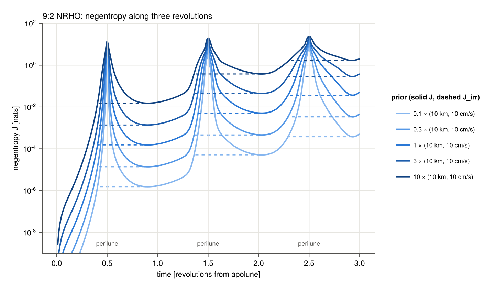
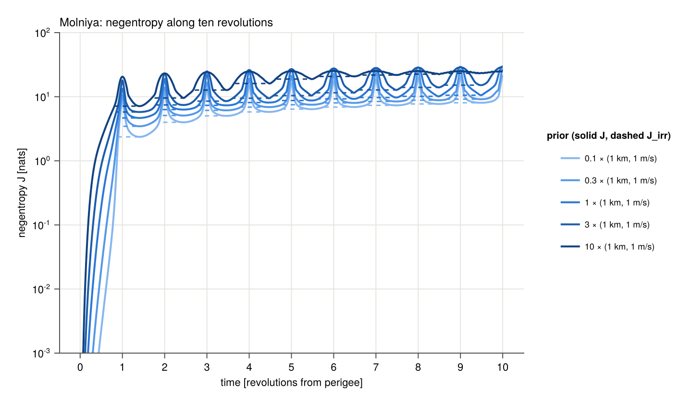
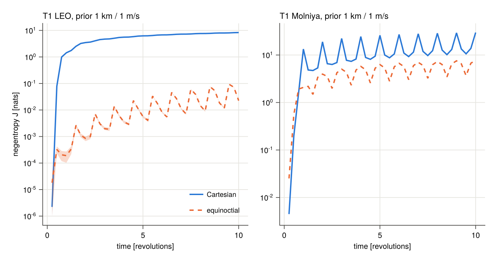
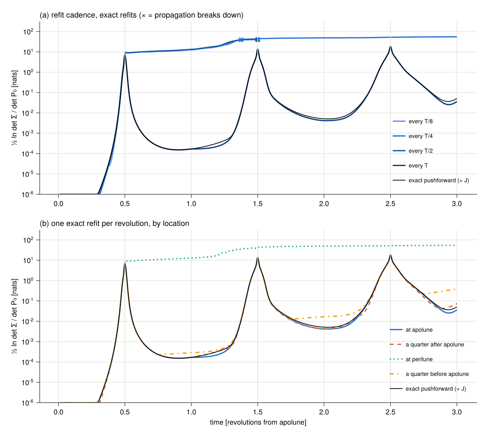
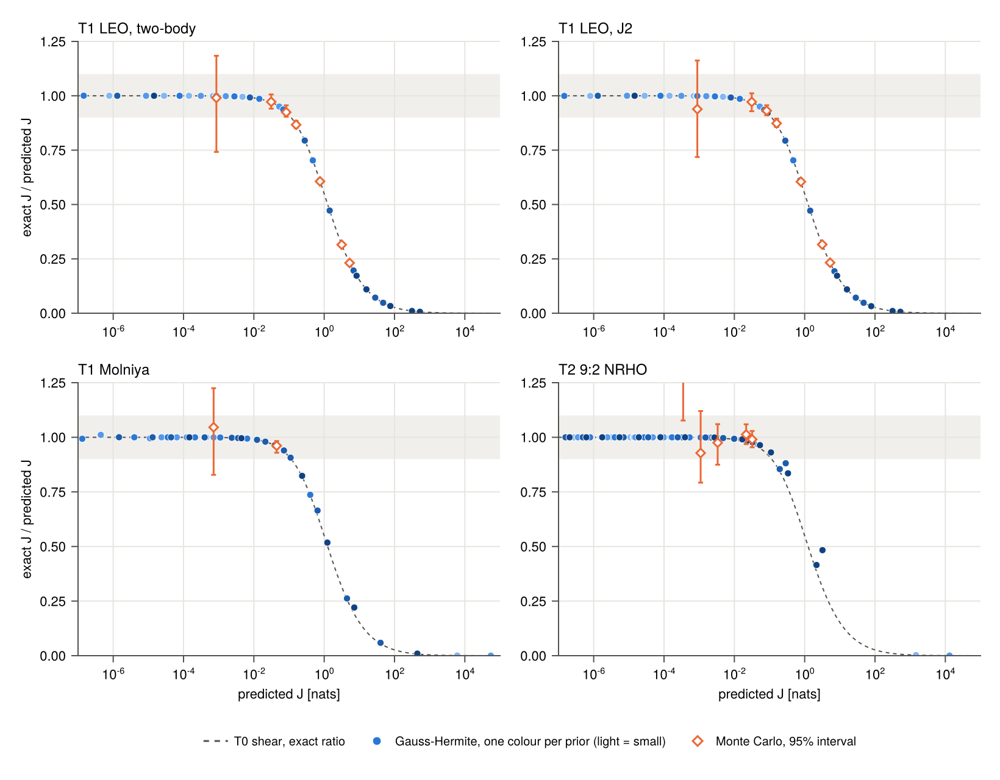
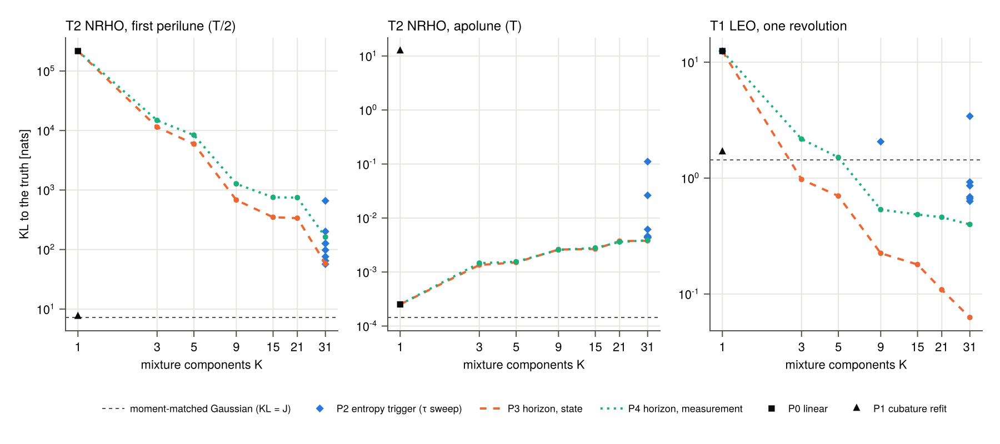
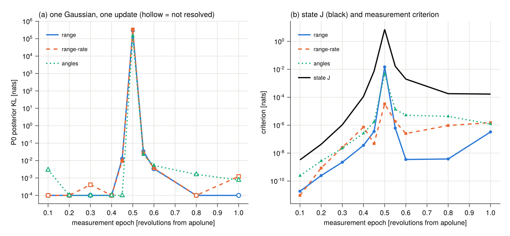
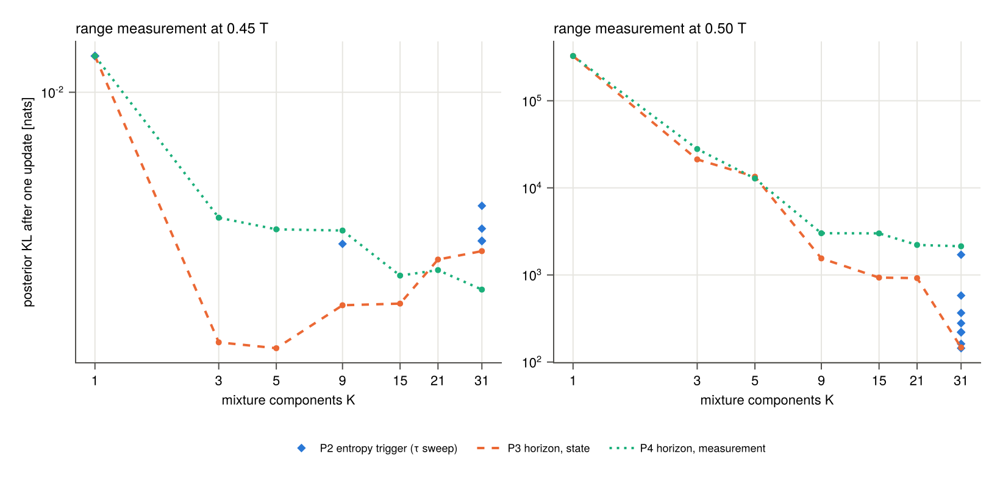
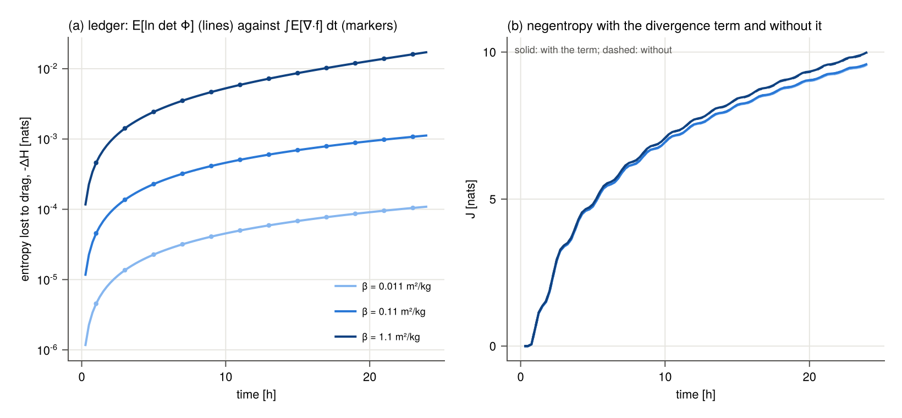

# Results

Generated by the scripts in `scripts/` (`julia --project=scripts -t auto scripts/reproduce_all.jl`). Do not edit by hand.

## E1: reversible and irreversible negentropy

**(a) 9:2 NRHO.** Prior s × (10 km, 10 cm/s) per axis at apolune. J from a 5⁶ Gauss-Hermite rule.
"Reversible fraction" is J_rev/J at the first perilune, with J_irr taken over the three-revolution horizon.

| prior s | J at 1st perilune | J_irr at 1st perilune | reversible fraction | J at 1 rev | J at 2 rev | J at 3 rev |
|---|---|---|---|---|---|---|
| 0.1 | 4.01 | 1.52e-06 | 1.0000 | 1.69e-06 | 5.16e-05 | 0.000519 |
| 0.3 | 5.21 | 1.37e-05 | 1.0000 | 1.52e-05 | 0.000465 | 0.00466 |
| 1 | 7.23 | 0.000152 | 1.0000 | 0.000169 | 0.00514 | 0.0507 |
| 3 | 10.4 | 0.00137 | 0.9999 | 0.00152 | 0.0449 | 0.389 |
| 10 | 13.8 | 0.0151 | 0.9989 | 0.0167 | 0.385 | 1.99 |

*Negentropy along three revolutions of the 9:2 NRHO, one line per prior size (log scale).
Solid lines are J(t); dashed lines are J_irr(t) = min over s ≥ t of J(s). The gap between them
is the reversible part: at each perilune J rises by four to eight orders of magnitude, and it
falls back again by apolune.*

**(b) Molniya.** Prior s × (1 km, 1 m/s) per axis at perigee. Ten revolutions; J from the same rule.

| prior s | J at 1st apogee | J at 1st perigee | J_irr at 1st perigee | J at 10th apogee | J at 10th perigee |
|---|---|---|---|---|---|
| 0.1 | 0.00235 | 9.31 | 2.36 | 8.05 | 21.7 |
| 0.3 | 0.0208 | 10.5 | 3.46 | 9.15 | 27.1 |
| 1 | 0.194 | 13.3 | 4.66 | 10.6 | 29.7 |
| 3 | 0.851 | 17.9 | 5.77 | 15.2 | 29.1 |
| 10 | 2.18 | 20.5 | 7.13 | 23.5 | 25.2 |

*Negentropy along ten Molniya revolutions. J peaks at every perigee and drops at apogee. The
irreversible floor (dashed) grows from one revolution to the next. At large priors J at the
10th perigee falls as the prior grows: the cloud is spread along a large arc of the orbit, its
covariance is bounded by the orbit's size, and ln det P₀ keeps growing as 12 ln s. Gauss-Hermite
with 5⁶ and 7⁶ nodes and Monte Carlo agree to within 0.6% at s = 3 and 10.*

**(c) Coordinates.** Paired Monte Carlo, N = 2×10⁵, 95% bootstrap intervals (B = 100). The
equinoctial negentropy includes the Jacobian term, E[ln |det ∂q/∂x|].

| orbit | revolutions | J Cartesian [95% CI] | J equinoctial [95% CI] |
|---|---|---|---|
| T1 LEO | 1 | 1.439 [1.431, 1.448] | 0.0001896 [0.0001028, 0.0002727] |
| T1 LEO | 10 | 8.312 [8.304, 8.322] | 0.02255 [0.0215, 0.02367] |
| T1 Molniya | 1 | 13.34 [13.3, 13.37] | 2.079 [2.058, 2.095] |
| T1 Molniya | 10 | 29.73 [29.71, 29.74] | 7.757 [7.749, 7.765] |

*The same uncertainty measured in Cartesian and in modified equinoctial coordinates. The bands
are 95% bootstrap intervals.*

**Spot checks of the Gauss-Hermite values** against paired Monte Carlo (N = 2×10⁵, 95% interval):

| case | Gauss-Hermite | Monte Carlo |
|---|---|---|
| NRHO s = 1, t = 0.500 T | 7.229 | 7.246 [7.229, 7.263] |
| NRHO s = 1, t = 1.000 T | 0.0001687 | 0.0001261 [5.67e-05, 0.0002242] |
| NRHO s = 1, t = 2.500 T | 18.39 | 18.42 [18.39, 18.45] |
| NRHO s = 10, t = 0.500 T | 13.75 | 13.77 [13.75, 13.79] |
| NRHO s = 10, t = 1.000 T | 0.01672 | 0.01637 [0.01569, 0.01738] |
| NRHO s = 10, t = 2.500 T | 23.31 | 23.32 [23.3, 23.33] |
| Molniya s = 1, t = 0.500 T | 0.1943 | 0.1934 [0.1899, 0.1968] |
| Molniya s = 1, t = 1.000 T | 13.33 | 13.31 [13.29, 13.34] |
| Molniya s = 1, t = 10.000 T | 29.74 | 29.72 [29.71, 29.74] |

*commit f7383d6+dirty; Julia 1.12.3, 10 threads; LiouvilleMixtures 0.1.0-DEV, OrbitalMechanics 1.0.0@98a43ae, EstimationToolkit 0.9.1@9337396, OrdinaryDiffEqVerner 2.4.2, ForwardDiff 0.10.39, CairoMakie 0.15.15; seed 101; run time 431 s; 2026-11-27 16:58*

## E2: refit ratchet against cadence and location

9:2 NRHO, prior 1 × (10 km, 10 cm/s) per axis at apolune, three revolutions. The "volume" is
½ ln det Σ(t)/det P₀. For the exact pushforward it equals J(t), by I2. "Gain over exact" is the
refitted volume minus the exact volume at 3T. "Smallest step" is the smallest change in volume
from one refit to the next: H1 predicts it is ≥ 0 for exact refits.

| schedule | refit rule | refits in 3 rev | volume at 3T [nats] | gain over exact at 3T [nats] | smallest step between refits [nats] |
|---|---|---|---|---|---|
| every T/8 | exact (GH 5⁶) | 11 | breaks down after 1.38 T | – | 6.17e-09 |
| every T/8 | cubature | 24 | 55.75 | 55.7 | -0.00321 |
| every T/4 | exact (GH 5⁶) | 12 | 55.11 | 55.06 | 1.92e-07 |
| every T/4 | cubature | 12 | 56 | 55.95 | 1.75e-07 |
| every T/2 | exact (GH 5⁶) | 3 | breaks down after 1.50 T | – | 5.56 |
| every T/2 | cubature | 6 | 48.33 | 48.28 | 1.2 |
| every T | exact (GH 5⁶) | 3 | 0.03617 | -0.01452 | 0.000169 |
| every T | cubature | 3 | 0.01807 | -0.03262 | 9.58e-05 |
| a quarter after apolune | exact (GH 5⁶) | 3 | 0.07413 | 0.02344 | 1.92e-07 |
| a quarter after apolune | cubature | 3 | 0.07204 | 0.02134 | 1.75e-07 |
| at perilune | exact (GH 5⁶) | 3 | 54.05 | 54 | 7.23 |
| at perilune | cubature | 3 | 50.45 | 50.4 | 6.56 |
| a quarter before apolune | exact (GH 5⁶) | 3 | 0.3807 | 0.33 | 0.000233 |
| a quarter before apolune | cubature | 3 | 0.2559 | 0.2052 | 0.000168 |

**Convergence.** One refit per revolution at perilune, rerun with the 7⁶ rule: the first
refit (t = 0.5 T) agrees with the 5⁶ rule (7.2292 against 7.2292 nats). It then breaks down after
t = 1.50 T, because its outermost nodes reach further and fall into the Moon (0.18 of its weight).
So every volume after the first perilune refit is not converged, and the totals of 48 to 56
nats in the table are indicative only. The first step, which equals J at perilune, is robust.

**Breakdowns.** Refitting at a perilune can put probability on trajectories that hit the
Moon. The point-mass model then has no surface to stop them, and integration fails as r → 0.
The true pushforward has no such mass. The exact-refit curves for these schedules stop at the
last refit that propagated.

- every T/8, exact (GH 5⁶): the Gaussian refitted at t = 1.38 T has 0.19 of its quadrature weight on trajectories that pass below the lunar surface within the next interval.
- every T/2, exact (GH 5⁶): the Gaussian refitted at t = 1.50 T has 0.17 of its quadrature weight on trajectories that pass below the lunar surface within the next interval.

*Covariance volume of a single Gaussian refitted on a schedule (coloured lines), against the
exact pushforward (black, thin), on a log scale. The exact volume rises at every perilune and
returns to near zero at apolune. A refit keeps whatever volume it finds, so after a refit the
volume can only step up. Any schedule with a refit at a perilune locks in that perilune's
volume, while refits near apolune stay close to the exact curve. (a) Refit cadence; × marks
where propagation breaks down. (b) One refit per revolution, placed at different points on
the orbit.*

*commit f7383d6+dirty; Julia 1.12.3, 10 threads; LiouvilleMixtures 0.1.0-DEV, OrbitalMechanics 1.0.0@98a43ae, EstimationToolkit 0.9.1@9337396, OrdinaryDiffEqVerner 2.4.2, ForwardDiff 0.10.39, CairoMakie 0.15.15; seed 202; run time 95 s; 2026-11-27 16:59*

## E3: negentropy predictor against the exact negentropy

Predicted against exact negentropy over every problem, output time and prior size. Times:
- T1: quarter revolutions up to 2 revolutions (LEO), eighth revolutions up to 1 revolution (Molniya).
- T2: 1/24 revolution up to 1 revolution.

Priors: s × (1 km, 1 m/s) for T1, s × (10 km, 10 cm/s) for T2. "Leaves [0.9, 1.1]" is the
smallest predicted J at which a point falls outside ±10%, with points sorted by predicted J.

| problem | points kept (of total) | J_pred where exact/pred first leaves [0.9, 1.1] | largest J_pred with all points within 10% below it | Monte Carlo against Gauss-Hermite (prior s; median relative difference where resolved) |
|---|---|---|---|---|
| T1 LEO, two-body | 45 (48) | 0.159 | 0.0859 | s = 0.1; 7 resolved, median 0.0021 |
| T1 LEO, J2 | 45 (48) | 0.159 | 0.0885 | s = 0.1; 7 resolved, median 0.0044 |
| T1 Molniya | 45 (56) | 0.236 | 0.111 | s = 0.01; 3 resolved, median 0.0030 |
| T2 9:2 NRHO | 113 (120) | 0.195 | 0.11 | s = 1; 6 resolved, median 0.0278 |

All problems pooled:

| predicted J [nats] | points | median exact/pred | worst exact/pred | worst exact / ½ln(1+2 pred) |
|---|---|---|---|---|
| 1e-07 – 0.001 | 100 | 1.000 | 1.011 | 1.011 |
| 0.001 – 0.01 | 36 | 0.997 | 0.992 | 1.003 |
| 0.01 – 0.03 | 12 | 0.988 | 0.980 | 1.007 |
| 0.03 – 0.1 | 20 | 0.961 | 0.921 | 1.015 |
| 0.1 – 0.3 | 11 | 0.854 | 0.792 | 1.116 |
| 0.3 – 1 | 9 | 0.665 | 0.602 | 1.091 |
| 1 – 10 | 17 | 0.315 | 0.172 | 1.548 |
| 10 – Inf | 26 | 0.007 | 0.000 | 1.600 |

Largest deviation of the exact J from the shear closure ½ ln(1 + 2 J_pred):

| problem | over J_pred < 1 nat | over J_pred < 10 nats |
|---|---|---|
| T1 LEO, two-body | 0.0% | 0.0% |
| T1 LEO, J2 | 0.1% | 0.1% |
| T1 Molniya | 3.5% | 15.9% |
| T2 9:2 NRHO | 11.6% | 54.8% |

*Exact negentropy divided by the leading-order prediction, against the prediction. One panel
per problem, one colour per prior size. The grey band is ±10%, and the dashed line is the
exact ratio for the T0 shear map, ln(1 + 2k²)/(2k²) at J_pred = k². In all four problems the
predictor is within 10% up to a predicted J of about 0.1 nats. Beyond that the points follow
the shear curve: the true negentropy behaves like ½ ln(1 + 2 J_pred), far past leading order.
On LEO this holds to 0.1% up to 10 nats, where the nonlinearity is the curvature of the arc, a
quadratic shear like T0's. On Molniya and the NRHO it holds to about 12% up to 1 nat and
departs beyond. This is an empirical observation, not a derived result. Diamonds are paired
Monte Carlo with 95% intervals.*

*commit f7383d6+dirty; Julia 1.12.3, 10 threads; LiouvilleMixtures 0.1.0-DEV, OrbitalMechanics 1.0.0@98a43ae, EstimationToolkit 0.9.1@9337396, OrdinaryDiffEqVerner 2.4.2, ForwardDiff 0.10.39, CairoMakie 0.15.15; seed 303; run time 173 s; 2026-11-27 17:02*

## E4: prediction-only accuracy against component count

Prediction-only accuracy: KL from the true propagated density to each policy's approximation,
against the number of components K (95% intervals, N = 2×10⁵). P3 and P4 split greedily to a
cap K (τ = 0). P2's threshold is swept (τ = 1e-7 … 1, cap 31), and each run is reported at the
component count it reached. "Moment-matched Gaussian (= J)" is the lowest KL any single
Gaussian can reach.

| case | policy | KL [95% CI] at K components |
|---|---|---|
| T2 NRHO, first perilune (T/2) | moment-matched Gaussian (= J) | K = 1: 7.22 |
| T2 NRHO, first perilune (T/2) | P0 linear | K = 1: 2.16e+05 [2.13e+05, 2.19e+05] |
| T2 NRHO, first perilune (T/2) | P1 cubature refit | K = 1: 7.49 [7.47, 7.51] |
| T2 NRHO, first perilune (T/2) | P2 entropy trigger | τ = 1e-07: K = 31, 659 [579, 739]; τ = 1e-06: K = 31, 201 [165, 237]; τ = 1e-05: K = 31, 127 [101, 152]; τ = 1e-04: K = 31, 76 [58.9, 93.1]; τ = 1e-03: K = 31, 56.8 [43.2, 70.5]; τ = 1e-02: K = 31, 64.8 [51.7, 77.8]; τ = 1e-01: K = 31, 98.2 [80.1, 116]; τ = 1e+00: K = 31, 126 [104, 148] |
| T2 NRHO, first perilune (T/2) | P3 horizon, state | K = 1: 2.16e+05 [2.13e+05, 2.19e+05]; K = 3: 1.14e+04 [1.1e+04, 1.18e+04]; K = 5: 5.94e+03 [5.68e+03, 6.21e+03]; K = 9: 680 [620, 740]; K = 15: 349 [307, 391]; K = 21: 337 [295, 379]; K = 31: 58.5 [46.8, 70.1] |
| T2 NRHO, first perilune (T/2) | P4 horizon, measurement | K = 1: 2.16e+05 [2.13e+05, 2.19e+05]; K = 3: 1.48e+04 [1.43e+04, 1.53e+04]; K = 5: 8.38e+03 [8.01e+03, 8.74e+03]; K = 9: 1.27e+03 [1.17e+03, 1.37e+03]; K = 15: 754 [680, 827]; K = 21: 746 [672, 819]; K = 31: 162 [137, 187] |
| T2 NRHO, apolune (T) | moment-matched Gaussian (= J) | K = 1: 0.000144 |
| T2 NRHO, apolune (T) | P0 linear | K = 1: 0.000252 [0.00015, 0.000353] |
| T2 NRHO, apolune (T) | P1 cubature refit | K = 1: 12.3 [12.3, 12.3] |
| T2 NRHO, apolune (T) | P2 entropy trigger | τ = 1e-07: K = 31, 0.00432 [0.00385, 0.00478]; τ = 1e-06: K = 31, 0.00441 [0.00394, 0.00488]; τ = 1e-05: K = 31, 0.00437 [0.0039, 0.00483]; τ = 1e-04: K = 31, 0.00443 [0.00397, 0.00489]; τ = 1e-03: K = 31, 0.00461 [0.00417, 0.00506]; τ = 1e-02: K = 31, 0.00615 [0.00564, 0.00666]; τ = 1e-01: K = 31, 0.0263 [0.0252, 0.0273]; τ = 1e+00: K = 31, 0.111 [0.108, 0.113] |
| T2 NRHO, apolune (T) | P3 horizon, state | K = 1: 0.000252 [0.00015, 0.000353]; K = 3: 0.00135 [0.00112, 0.00158]; K = 5: 0.00151 [0.00126, 0.00175]; K = 9: 0.00261 [0.00229, 0.00293]; K = 15: 0.00267 [0.00234, 0.003]; K = 21: 0.00374 [0.00334, 0.00413]; K = 31: 0.00379 [0.00339, 0.0042] |
| T2 NRHO, apolune (T) | P4 horizon, measurement | K = 1: 0.000252 [0.00015, 0.000353]; K = 3: 0.00146 [0.00122, 0.0017]; K = 5: 0.00155 [0.0013, 0.0018]; K = 9: 0.00257 [0.00225, 0.0029]; K = 15: 0.00279 [0.00245, 0.00313]; K = 21: 0.0036 [0.00322, 0.00399]; K = 31: 0.00387 [0.00347, 0.00428] |
| T1 LEO, one revolution | moment-matched Gaussian (= J) | K = 1: 1.43 |
| T1 LEO, one revolution | P0 linear | K = 1: 12.5 [12.3, 12.6] |
| T1 LEO, one revolution | P1 cubature refit | K = 1: 1.68 [1.66, 1.7] |
| T1 LEO, one revolution | P2 entropy trigger | τ = 1e-07: K = 31, 0.859 [0.846, 0.872]; τ = 1e-06: K = 31, 3.42 [3.36, 3.47]; τ = 1e-05: K = 31, 0.924 [0.912, 0.936]; τ = 1e-04: K = 31, 0.632 [0.626, 0.639]; τ = 1e-03: K = 31, 0.665 [0.658, 0.672]; τ = 1e-02: K = 31, 0.688 [0.679, 0.696]; τ = 1e-01: K = 9, 2.06 [2.03, 2.1]; τ = 1e+00: K = 1, 12.5 [12.3, 12.6] |
| T1 LEO, one revolution | P3 horizon, state | K = 1: 12.5 [12.3, 12.6]; K = 3: 0.974 [0.949, 0.999]; K = 5: 0.7 [0.682, 0.719]; K = 9: 0.225 [0.22, 0.23]; K = 15: 0.18 [0.176, 0.184]; K = 21: 0.109 [0.105, 0.113]; K = 31: 0.0628 [0.061, 0.0645] |
| T1 LEO, one revolution | P4 horizon, measurement | K = 1: 12.5 [12.3, 12.6]; K = 3: 2.17 [2.13, 2.22]; K = 5: 1.51 [1.47, 1.54]; K = 9: 0.535 [0.525, 0.544]; K = 15: 0.485 [0.477, 0.492]; K = 21: 0.459 [0.452, 0.467]; K = 31: 0.398 [0.395, 0.402] |

*KL to the truth against component count. The dashed line is the moment-matched Gaussian
(KL = J). Squares mark the linear P0 and triangles the single-Gaussian cubature refit, both
at K = 1. Lines are the three splitting policies: P3 and P4 split greedily up to K, and P2 is
shown across its threshold sweep.*

*commit f7383d6+dirty; Julia 1.12.3, 10 threads; LiouvilleMixtures 0.1.0-DEV, OrbitalMechanics 1.0.0@98a43ae, EstimationToolkit 0.9.1@9337396, OrdinaryDiffEqVerner 2.4.2, ForwardDiff 0.10.39, CairoMakie 0.15.15; seed 404; run time 82 s; 2026-11-27 17:04*

## E5: posterior accuracy after one update

9:2 NRHO, prior 1 × (10 km, 10 cm/s) at apolune. One measurement from the Earth's centre, with
σ = 0.2 × its predicted linear standard deviation (for angles, of the wider axis). The
exact posterior comes from N = 5×10⁵ importance-weighted prior samples. KL is averaged over
16 measurement draws, with a 95% interval from their spread. A case is resolved if its
interval excludes zero and its smallest ESS is at least 100.

**(a) Along the orbit.**

| epoch [T] | measurement | σ | exact state J | measurement criterion | P0 posterior KL [95% CI] | min ESS | resolved |
|---|---|---|---|---|---|---|---|
| 0.10 | range | 6.06e-06 | 3.27e-09 | 1.86e-11 | -0.000348 [-0.00192, 0.00123] | 37628 | no |
| 0.10 | range-rate | 1.98e-05 | 3.27e-09 | 9.34e-12 | 9.89e-06 [-0.00384, 0.00386] | 1198 | no |
| 0.10 | angles | 5.84e-06 | 3.27e-09 | 2.38e-10 | 0.00294 [-0.00277, 0.00866] | 622 | no |
| 0.20 | range | 8.1e-06 | 4.29e-08 | 2.46e-10 | -0.000741 [-0.00221, 0.000728] | 13858 | no |
| 0.20 | range-rate | 2.04e-05 | 4.29e-08 | 8.53e-10 | -0.000669 [-0.004, 0.00266] | 4657 | no |
| 0.20 | angles | 8.15e-06 | 4.29e-08 | 2.72e-09 | -0.000142 [-0.00505, 0.00477] | 3321 | no |
| 0.30 | range | 1.06e-05 | 1.07e-06 | 2.22e-09 | -0.000552 [-0.00263, 0.00153] | 4585 | no |
| 0.30 | range-rate | 1.95e-05 | 1.07e-06 | 2.55e-08 | 0.00041 [-0.00199, 0.00281] | 3246 | no |
| 0.30 | angles | 1.18e-05 | 1.07e-06 | 2.22e-08 | -0.00169 [-0.00662, 0.00323] | 4541 | no |
| 0.40 | range | 1.25e-05 | 0.000113 | 3.6e-08 | -0.00066 [-0.00316, 0.00184] | 6739 | no |
| 0.40 | range-rate | 1.24e-05 | 0.000113 | 7.25e-07 | -0.000768 [-0.00247, 0.000934] | 34449 | no |
| 0.40 | angles | 1.86e-05 | 0.000113 | 2.62e-07 | -0.00191 [-0.00522, 0.00141] | 3625 | no |
| 0.45 | range | 1.23e-05 | 0.00746 | 3.55e-07 | 0.0129 [0.0054, 0.0203] | 2979 | yes |
| 0.45 | range-rate | 2.39e-05 | 0.00746 | 4.78e-08 | 0.00939 [0.00789, 0.0109] | 21349 | yes |
| 0.45 | angles | 2.63e-05 | 0.00746 | 1.73e-06 | -0.000207 [-0.00478, 0.00437] | 4123 | no |
| 0.50 | range | 5.24e-07 | 7.23 | 0.0148 | 2.92e+05 [1.26e+05, 4.58e+05] | 3151 | yes |
| 0.50 | range-rate | 0.00105 | 7.23 | 3.35e-05 | 3.41e+05 [8.17e+04, 6e+05] | 6863 | yes |
| 0.50 | angles | 9.42e-05 | 7.23 | 0.00457 | 1.44e+05 [2.92e+04, 2.58e+05] | 24676 | yes |
| 0.55 | range | 1.77e-05 | 0.0165 | 6.15e-07 | 0.0341 [0.0112, 0.0571] | 3437 | yes |
| 0.55 | range-rate | 8.37e-05 | 0.0165 | 1.83e-06 | 0.0268 [0.015, 0.0387] | 4881 | yes |
| 0.55 | angles | 3.85e-05 | 0.0165 | 1.35e-05 | 0.0223 [0.00389, 0.0407] | 9699 | yes |
| 0.60 | range | 2.17e-05 | 0.002 | 3.5e-09 | 0.0034 [-0.000459, 0.00726] | 10141 | no |
| 0.60 | range-rate | 4.13e-05 | 0.002 | 2.51e-07 | 0.00364 [0.00227, 0.00502] | 28086 | yes |
| 0.60 | angles | 2.92e-05 | 0.002 | 5.18e-06 | 0.00526 [0.00046, 0.0101] | 5545 | yes |
| 0.80 | range | 2.57e-05 | 0.000181 | 3.79e-09 | -0.000164 [-0.00211, 0.00178] | 5250 | no |
| 0.80 | range-rate | 2.44e-05 | 0.000181 | 9.45e-07 | -0.000381 [-0.0025, 0.00174] | 13168 | no |
| 0.80 | angles | 2.28e-05 | 0.000181 | 4.28e-06 | 0.00161 [-0.00395, 0.00717] | 1486 | no |
| 1.00 | range | 2.76e-05 | 0.000169 | 3.29e-07 | -0.00125 [-0.00288, 0.000378] | 6197 | no |
| 1.00 | range-rate | 2.16e-05 | 0.000169 | 1.53e-06 | 0.00123 [-0.00144, 0.0039] | 8366 | no |
| 1.00 | angles | 2.27e-05 | 0.000169 | 1.22e-06 | 0.000768 [-0.00403, 0.00557] | 3859 | no |

*(a) Posterior KL of a single linear Gaussian (P0) after one EKF update, against the
measurement epoch, for each measurement type. Hollow markers are not resolved (interval
includes zero, or ESS < 100). The error is resolved only between 0.45 and 0.6 T, around
perilune. (b) The two criteria at the same epochs: the exact state negentropy J (black), which
is the same for all three measurement types, and the measurement-space criterion (coloured),
which differs by type. The state J peaks where the posterior error does. The measurement
criterion does not order the measurement types the way their posterior errors are ordered.*

**(b) H5: posterior accuracy against component count**, range measurements.

| epoch | policy | posterior KL [95% CI] (components) |
|---|---|---|
| 0.45 T | P2 entropy trigger | τ = 1e-07: 0.00515 [0.00305, 0.00726] (K = 31); τ = 1e-06: 0.00451 [0.00258, 0.00645] (K = 31); τ = 1e-05: 0.00419 [0.00234, 0.00605] (K = 31); τ = 1e-04: 0.0042 [0.00236, 0.00605] (K = 31); τ = 1e-03: 0.00413 [0.00198, 0.00627] (K = 9); τ = 1e-02: 0.0124 [0.00667, 0.018] (K = 1); τ = 1e-01: 0.0124 [0.00667, 0.018] (K = 1); τ = 1e+00: 0.0124 [0.00667, 0.018] (K = 1) |
| 0.45 T | P3 horizon, state | K = 1: 0.0124 [0.00667, 0.018]; K = 3: 0.00232 [0.000296, 0.00435]; K = 5: 0.00224 [0.000192, 0.0043]; K = 9: 0.00288 [0.000867, 0.0049]; K = 15: 0.00291 [0.000887, 0.00494]; K = 21: 0.00377 [0.0018, 0.00574]; K = 31: 0.00396 [0.00199, 0.00592] |
| 0.45 T | P4 horizon, measurement | K = 1: 0.0124 [0.00667, 0.018]; K = 3: 0.00481 [0.00268, 0.00694]; K = 5: 0.00449 [0.00249, 0.0065]; K = 9: 0.00446 [0.00249, 0.00643]; K = 15: 0.00343 [0.00124, 0.00562]; K = 21: 0.00354 [0.00145, 0.00563]; K = 31: 0.00316 [0.00116, 0.00516] |
| 0.45 T | smallest ESS over all runs | 3689 |
| 0.50 T | P2 entropy trigger | τ = 1e-07: 1.71e+03 [-249, 3.67e+03] (K = 31); τ = 1e-06: 581 [-288, 1.45e+03] (K = 31); τ = 1e-05: 366 [-191, 923] (K = 31); τ = 1e-04: 219 [-117, 555] (K = 31); τ = 1e-03: 162 [-86.8, 410] (K = 31); τ = 1e-02: 144 [11.7, 277] (K = 31); τ = 1e-01: 221 [23.7, 419] (K = 31); τ = 1e+00: 279 [38.8, 519] (K = 31) |
| 0.50 T | P3 horizon, state | K = 1: 3.27e+05 [1.27e+05, 5.26e+05]; K = 3: 2.12e+04 [3.95e+03, 3.85e+04]; K = 5: 1.34e+04 [-2.78e+03, 2.96e+04]; K = 9: 1.55e+03 [2.31, 3.1e+03]; K = 15: 933 [-395, 2.26e+03]; K = 21: 920 [-409, 2.25e+03]; K = 31: 147 [-33.2, 328] |
| 0.50 T | P4 horizon, measurement | K = 1: 3.27e+05 [1.27e+05, 5.26e+05]; K = 3: 2.79e+04 [4.76e+03, 5.11e+04]; K = 5: 1.28e+04 [6.02e+03, 1.96e+04]; K = 9: 3.01e+03 [70, 5.96e+03]; K = 15: 3e+03 [55.6, 5.95e+03]; K = 21: 2.21e+03 [-488, 4.91e+03]; K = 31: 2.13e+03 [-569, 4.84e+03] |
| 0.50 T | smallest ESS over all runs | 2225 |

Smallest number of components whose posterior KL is below a fraction of P0's, counting a
target as reached when the upper end of the 95% interval is below it ("–" = not reached with
31 components):

| epoch | target: fraction of P0's posterior KL | target [nats] | P2 needs K | P3 needs K | P4 needs K |
|---|---|---|---|---|---|
| 0.45 T | 0.5 | 0.00618 | 31 | 3 | 15 |
| 0.45 T | 0.25 | 0.00309 | – | – | – |
| 0.45 T | 0.1 | 0.00124 | – | – | – |
| 0.50 T | 0.5 | 1.63e+05 | 31 | 3 | 3 |
| 0.50 T | 0.25 | 8.17e+04 | 31 | 3 | 3 |
| 0.50 T | 0.1 | 3.27e+04 | 31 | 5 | 5 |

**Split directions at perilune.** The whitened nonlinearity is essentially rank one: the
eigenvalues of Σₐ Bₐ², normalized, are 1.0e+00, 6.8e-06, 3.2e-06, 3.9e-11, 1.5e-11, 6.6e-13. So the state
and measurement criteria choose almost the same split direction, |u_state · u_meas| =
range 0.90141; range-rate 0.85451; angles 0.99999. At equal K, P3 and P4 then split almost identically. They can only
differ in how many splits they ask for at a given threshold.

*Posterior KL after one Gaussian-sum update against the number of prior components, for range
measurements at the approach to perilune and at perilune. P3 and P4 split greedily to K
components; P2 is shown across its threshold sweep.*

*commit f7383d6+dirty; Julia 1.12.3, 10 threads; LiouvilleMixtures 0.1.0-DEV, OrbitalMechanics 1.0.0@98a43ae, EstimationToolkit 0.9.1@9337396, OrdinaryDiffEqVerner 2.4.2, ForwardDiff 0.10.39, CairoMakie 0.15.15; seed 505; run time 362 s; 2026-11-27 17:10*

## E6: entropy ledger with drag

T3: circular LEO at 400 km with exponential-atmosphere drag, prior 1 km / 1 m/s, one day,
N = 2×10⁴ samples. Drag makes the flow contract phase volume (∇·f = -4·10³ β ρ |v| < 0), so the
entropy of the propagated density falls. "Relative closure error" compares two independent
computations of that loss: the mean of each sample's own ln det Φ, and the time integral of the
mean divergence (trapezoid, 15-minute steps).

| β [m²/kg] | -E[ln det Φ] after 1 day [nats] | -∫E[∇·f] dt [nats] | relative closure error | J with the term [95% CI] | J without it (naive I2) | relative error of naive I2 |
|---|---|---|---|---|---|---|
| 0.011 | 0.0001091 | 0.0001091 | 2.3e-06 | 9.5693 [9.5394, 9.5977] | 9.5691 | 1.1e-05 |
| 0.11 | 0.001124 | 0.001124 | 1.4e-06 | 9.6003 [9.5704, 9.6289] | 9.5992 | 1.2e-04 |
| 1.1 | 0.01723 | 0.01723 | 2.7e-05 | 9.9994 [9.9661, 10.0339] | 9.9822 | 1.7e-03 |

*(a) Entropy lost to drag over one day, computed two ways. Lines are the mean ln det Φ from each
sample's state transition matrix; markers are the integral of the mean flow divergence. (b) J
with the divergence term (solid) and without it (dashed). At realistic drag the term is many
orders of magnitude smaller than J. The ledger closes, but leaving the term out changes nothing
that matters here.*

*commit f7383d6+dirty; Julia 1.12.3, 10 threads; LiouvilleMixtures 0.1.0-DEV, OrbitalMechanics 1.0.0@98a43ae, EstimationToolkit 0.9.1@9337396, OrdinaryDiffEqVerner 2.4.2, ForwardDiff 0.10.39, CairoMakie 0.15.15; seed 606; run time 86 s; 2026-11-27 17:11*

